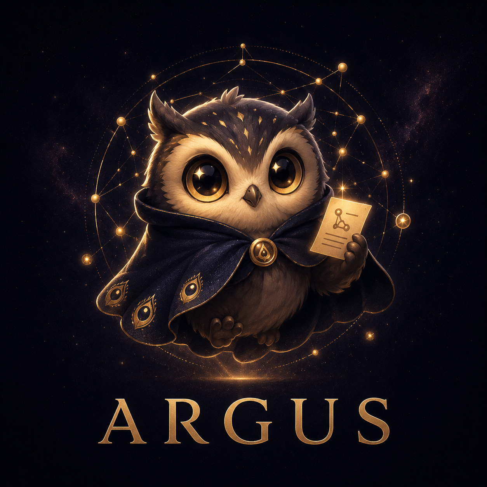
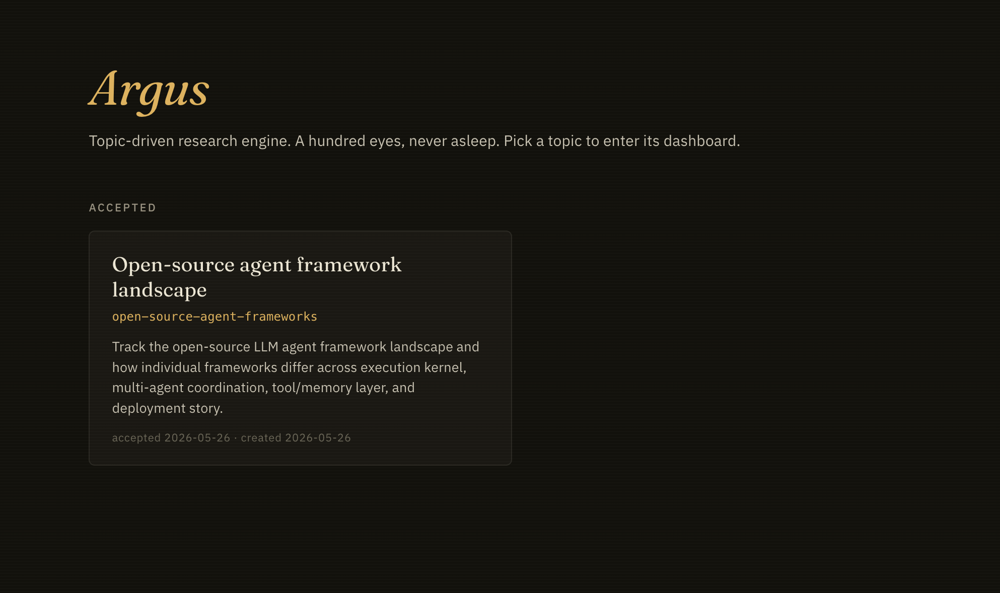
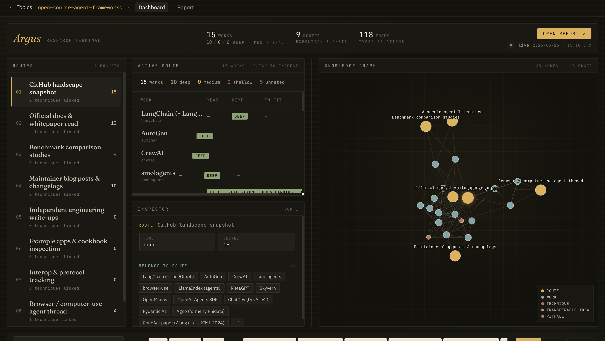
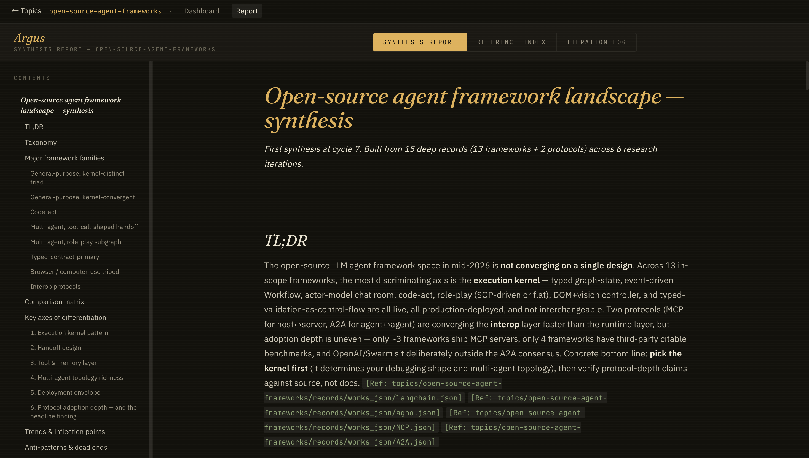

<div align="center">



# Argus 2.0

### Universal Deep Exploration & Decision-Intelligence Engine — from rare needle hunts to competitive landscapes and JEV-verified decisions.

<p>
  <a href="README.zh-CN.md">中文</a> · <b>English</b> · <a href="https://x32studio.com">X32 Studio</a> · <a href="https://github.com/X32Studio/self-loop">self-loop</a>
</p>

<sub>By <a href="https://github.com/k-r33">Ruiyuan Kang (k-r33)</a> @ <a href="https://x32studio.com">X32 Studio</a> (Kang &amp; his Agent Team) · MIT Licensed</sub>

</div>

---

> **Every deep search has the same first-principles purpose: resolve uncertainty and assemble trustworthy context — without burning human attention on shallow noise.**

One-shot deep-research tools print a 30-page essay and smooth over contradictions. Real work needs something sharper: whether you are **hunting one rare primary source**, **sweeping 50 competitors into a living matrix**, or **making a high-stakes architecture / product / investment decision**, Argus grows a **persistent, conflict-preserving evidence & decision graph** — and exposes it directly to your downstream agents (`self-loop`, Claude Code, Codex, Antigravity) via **`gather` / `search`**.

**Many eyes. Never asleep.**

---

## Four Universal Deep-Exploration Archetypes

| Archetype | When to use it | Primary Output |
| --- | --- | --- |
| **`hunt`** (Needle Hunt) | Locate a rare primary source, obscure repo, exact benchmark, regulatory clause, or hard-to-find root cause | Verified primary hit + provenance chain |
| **`intel`** (Competitive & Landscape Intel) | Sweep dozens of competitors, pricing models, repos, changelogs, and user signals into one living map | Structured competitor dossiers + landscape graph |
| **`decision`** (Decision Under Uncertainty) | Resolve a real bet (architecture choice, vendor selection, market entry) with explicit options & stakes | Calibrated option probabilities + **Flip Triggers** (*"What would flip this verdict?"*) |
| **`research`** (Long-Horizon Research Tree) | Track an evolving technical or scientific field across weeks without restarting from zero | Compounding knowledge tree + living synthesis brief |

---

## JEV Decision-Model Mode (`jev-hybrid` + Offline Baseline)

Built around a two-layer **JEV (Judgment & Evidence Verification)** protocol (`/v1/jev`), Argus 2.0 separates **fast zero-output-token routing** from **expensive heavy-LLM deep reads**:

1. **Layer 1 — Fast Relevance Routing (`type: "noul"`, `output_tokens == 0`)**: Screens every search candidate before heavy LLM reading. Drops only clear noise (`< 0.35`); **preserves ambiguous signals (`0.35–0.70`)** so rare needles and weak-signal contradictions are never silently discarded.
2. **Layer 2 — Calibrated Adjudication & Conflict Preservation (`type: "choice"`, `PASS_FLOOR = 0.70`)**: Aggregates controlling evidence across `{support, refute, unknown}`. Whenever authoritative sources directly conflict, Argus **refuses to fake consensus** — locking the claim as `contested` and auto-spawning a high-priority disambiguation probe for the next cycle.
3. **Layer 3 — Dual-Entry Agent Context (`gather` + `search`)**: One persistent topic store with two CLI entry points — `search` for precision needle lookup and `gather` for task-scoped, SHA-256 provenance-stamped context assembly fed directly into `self-loop` or any coding/strategy agent.

> **Zero-GPU Ready:** Ships with a deterministic **offline baseline** so anyone can run tests and the 5-second demo immediately. To enable live local JEV inference (e.g., loopback `:8001/v1/jev`), set `ARGUS_JEV_ENDPOINT`, `ARGUS_JEV_MODEL_ID`, and `ARGUS_JEV_KEY_FILE`.

---

## 5-Second Quick Start (Zero API Keys Required)

```bash
git clone https://github.com/X32Studio/Argus.git
cd Argus
npm run demo
```

Query the bundled competitive-intelligence & decision showcase (`topics/ai-coding-harness-selection`):

```bash
# Assemble task-scoped context for a downstream agent (gather mode)
node engine/cli.mjs query --topic ai-coding-harness-selection \
  --task "cross-vendor coding agent verification gates" --mode gather --format md

# Precision needle lookup (search mode)
node engine/cli.mjs query --topic ai-coding-harness-selection \
  --task "L-0002 state machine false verdicts" --mode search
```

Launch the interactive Dashboard (Graph + **Decision Board** + Living Report):

```bash
cd app && npm install && npm run dev
# Open http://localhost:5173/t/ai-coding-harness-selection/decisions
```

---

## Install as an Agent Skill (Claude Code / Codex / T3)

```bash
mkdir -p ~/.claude/skills
cp -r .claude/skills/argus ~/.claude/skills/argus
```

Then open any folder and start an exploration:

```text
/argus init "competitive analysis of AI coding harnesses (archetype: intel, engine: jev-hybrid)"
```

---

## Meet Argus

<div align="center">
  
</div>

<table>
  <tr>
    <td width="33%" align="center">
      
      <br />
      <sub><b>Start with one command.</b><br />Pick an archetype (<code>hunt</code> / <code>intel</code> / <code>decision</code> / <code>research</code>) and plant the tree.</sub>
    </td>
    <td width="33%" align="center">
      
      <br />
      <sub><b>Graph + Decision Board.</b><br />Inspect routes, JEV probabilities, active conflicts, and flip triggers.</sub>
    </td>
    <td width="33%" align="center">
      
      <br />
      <sub><b>Living brief + Agent Context.</b><br />Feed verified evidence directly into <code>self-loop</code> via <code>gather</code>/<code>search</code>.</sub>
    </td>
  </tr>
</table>

---

## Part of the X32 Agentic Stack

Built by **[Ruiyuan Kang (`k-r33`)](https://github.com/k-r33)** @ **[X32 Studio](https://x32studio.com)** (Kang & his Agent Team):

- **L1 · [`self-loop`](https://github.com/X32Studio/self-loop)** — Turns a chaotic agent mob into a trustworthy delivery organization (Frame Review + cross-vendor Critic/Actor/Judge + exact-tree Git/CI gates)
- **L2 · [`best-practice-for-skills-system`](https://github.com/X32Studio/best-practice-for-skills-system)** — Systems-engineering architecture for multi-skill agent collections
- **L3 · `Argus` (this repo)** — Universal deep exploration, JEV decision intelligence & `gather`/`search` agent context
- **L4 · [`agent-dao-public`](https://github.com/X32Studio/agent-dao-public)** — First-principles monograph on the past, future, and destiny of autonomous agents
